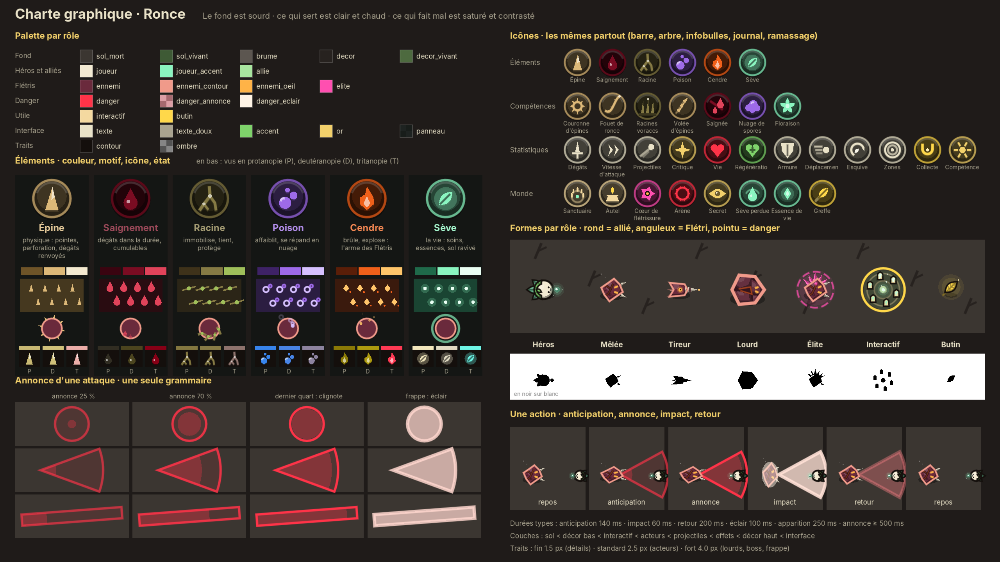
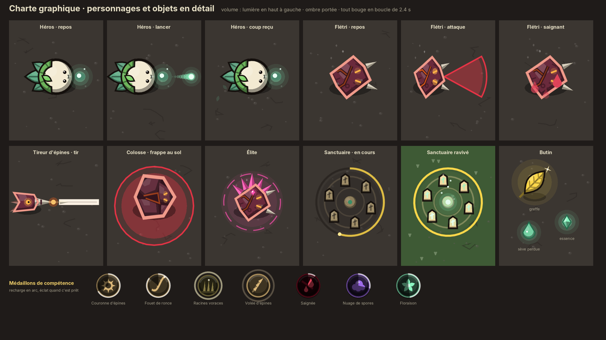

# Charte graphique

Ce document fixe le langage visuel du jeu. Il vaut pour la zone de Ronce et pour les branches à venir. Tout est dessiné par le code. Les valeurs vivent dans `godot/scripts/art.gd` (classe `Art`) et `godot/scripts/anim.gd` (classe `Anim`), et la planche `godot/tests/visual/reference/charte.png` les montre toutes. Aucune couleur, épaisseur, ombre ou durée n'est écrite en dur ailleurs.

## 1. Hiérarchie de lecture

On doit lire l'écran en une seconde, dans cet ordre :

1. **Ce qui fait mal** est saturé et contrasté : rouge `danger`, éclair blanc chaud, Flétris sombres à contour clair.
2. **Ce qui se ramasse ou s'utilise** est clair et chaud : `interactif` (pierre claire), `butin` (or).
3. **Le héros** est clair et rond, crème avec un accent de sève.
4. **Le fond** est sourd, sombre et désaturé : sol, brume, décor. Il ne doit jamais attirer l'œil plus qu'un ennemi.

Le test `art_test.gd` vérifie ces règles : le fond reste sombre et peu saturé, ce qui est utile reste clair, le danger reste vif, et le contour des Flétris contraste avec le sol mort.

## 2. Palette par rôle

On demande une couleur par son rôle, jamais par sa teinte : `Art.c("ennemi")`, pas un code hexadécimal.

| Groupe | Rôles |
| --- | --- |
| Fond | `sol_mort`, `sol_vivant`, `brume`, `decor`, `decor_vivant` |
| Héros et alliés | `joueur`, `joueur_accent`, `allie` |
| Flétris | `ennemi`, `ennemi_contour`, `ennemi_oeil`, `elite` |
| Danger | `danger`, `danger_annonce` (voile), `danger_eclair` (frappe) |
| Utile | `interactif`, `butin` |
| Interface | `texte`, `texte_doux`, `accent`, `or`, `panneau` (repris tels quels par `ui_theme.gd`) |
| Traits | `contour`, `ombre` |

## 3. Éléments

Chaque élément a une couleur principale, une couleur claire (reflet, cœur d'une lueur), une couleur sombre (contour, fond de motif), un **motif** et une **icône**. La couleur seule ne suffit jamais : le motif porte aussi l'information.

| Élément | Couleur | Motif | Sens |
| --- | --- | --- | --- |
| Épine | ocre et blanc os | pointes | physique : pointes, perforation, dégâts renvoyés |
| Saignement | rouge profond | gouttes qui perlent et tombent | dégâts dans la durée, cumulables |
| Racine | brun et vert mousse | traits noueux | immobilise, tient, protège |
| Poison | violet | bulles qui montent | affaiblit, se répand en nuage |
| Cendre | orange braise | braises qui s'envolent | brûle, explose : l'arme des Flétris |
| Sève | vert lumineux | lueur douce qui respire | la vie : soins, essences, sol ravivé |

**Daltonisme.** Les couleurs sont choisies pour rester distinctes en protanopie, en deutéranopie et en tritanopie (simulation de Machado 2009). Le rouge du saignement est très sombre, la racine est d'un brun moyen, la cendre est vive et l'épine est claire. Ainsi, même quand les teintes se confondent, les clartés restent différentes. Le test exige un écart perçu (ΔE) d'au moins 20 entre deux éléments, pour chaque forme de daltonisme. Le pire cas actuel est d'environ 21. La planche montre chaque élément tel que le voit chaque forme de daltonisme.

**Compétences.** Chaque compétence prend l'élément qui la domine (`Art.ELEMENT_DE_COMPETENCE`) :
- Couronne d'épines, Fouet de ronce, Volée d'épines : épine ;
- Racines voraces : racine ;
- Saignée : saignement ;
- Nuage de spores : poison ;
- Floraison : sève.

Fonctions : `Art.ec(element, "couleur" | "clair" | "sombre")`, `Art.motif(ci, element, rect, t)` (échantillon ou tuile), `Art.status(ci, element, pos, r, t)` (marque d'état animée autour d'un acteur : Flétri saignant, enraciné, empoisonné…).

## 4. Formes par rôle

- **Le héros et ses alliés sont ronds et organiques.** Ils ont des feuilles, des courbes et des contours doux. Le héros est un corps rond avec deux feuilles en cape. Une graine lumineuse devant lui indique où il vise.
- **Les Flétris sont anguleux et cassés.** Leurs polygones sont irréguliers, avec des encoches et des yeux fendus couleur de braise. Leur rôle se lit à la silhouette :
  - la **mêlée** est compacte, avec des griffes vers l'avant ;
  - le **tireur** est effilé et porte une longue pointe-canon ;
  - le **lourd** est un gros bloc à plaques, au trait fort ;
  - l'**élite** est un Flétri couronné de pointes, dans une aura magenta. Chaque modificateur garde son propre signe, à la couleur de son élément.
- **Les dangers sont pointus.** Ce sont des épines, des cônes et des lignes.
- **Ce qui s'utilise** est un cercle de pierres claires avec un anneau de progression. Le **butin** est une petite forme dorée qui flotte et scintille.

Toutes ces silhouettes doivent se reconnaître **en noir sur blanc**. La planche les montre aussi ainsi. Les silhouettes de la planche sont des exemples : la vague 2 dessine les vraies.

## 5. Traits, ombres, lumière

- Traits : `Art.TRAIT_FIN` (1,5 px : détails, motifs, petites icônes), `Art.TRAIT` (2,5 px : contour des acteurs), `Art.TRAIT_FORT` (4 px : lourds, boss, contour au moment de la frappe). `Art.outline(ci, points, couleur, épaisseur)`.
- Ombre portée : une ellipse aplatie sous l'acteur, légèrement vers le bas. La lumière vient d'en haut, un peu de face. `Art.shadow(ci, pos, r)`.
- Lueur : trois halos qui s'éclaircissent vers le centre, puis un cœur à la couleur claire de l'élément. `Art.glow(ci, pos, r, element)`. On la réserve à ce qui est vivant ou utile (sève, essences, sanctuaires). Un ennemi n'a pas de lueur, sauf l'aura d'une élite.
- Volume : les acteurs et objets importants ne sont pas des aplats. `Art.volume(ci, points, couleur)` et `Art.volume_circle(ci, pos, r, couleur)` donnent un côté ombre, une face éclairée (en haut à gauche) et un reflet. On ajoute ensuite les détails propres au rôle : nervures des feuilles du héros, fentes d'écorce où couve la braise chez les Flétris, plaques du Colosse, runes des sanctuaires (voir la planche « en détail »).
- Ordre de dessin (`Art.COUCHE`, valeurs de `z_index`) : sol < décor bas < objets interactifs < acteurs < projectiles < effets < décor haut < interface.

## 6. Annonce d'une attaque : une seule grammaire

Toutes les attaques des ennemis, des élites et du boss s'annoncent de la même façon, avec `Art.telegraph(ci, forme, progression, frappe, t)` :

1. **Annonce** (la progression va de 0 à 1) : la forme apparaît en contour rouge sur un voile léger. Un voile plus dense la remplit depuis l'origine de l'attaque. Pour un cercle, il part du centre ; pour un cône, de son sommet ; pour une ligne, de son départ.
2. **Dernier quart** : le contour clignote, le coup est imminent.
3. **Frappe** (de 0 à 1) : un éclair blanc chaud couvre toute la forme et prend un contour fort, puis s'éteint vers le rouge.

Il existe trois formes : `cercle` (zone), `cone` (éventail, souffle, coup de griffe) et `ligne` (charge, fouet, couloir). Une annonce dure au moins `Anim.DUREE["annonce_min"]`, soit 0,5 s. Le joueur ne doit jamais encaisser une attaque qu'il n'a pas pu voir venir.

## 7. Animation

Toute action suit trois temps :
- l'**anticipation** : l'acteur se ramasse et on voit l'action venir ;
- l'**impact** : un temps très court et marqué, souvent avec un éclair ;
- le **retour** : souple, amorti.

`Anim.squash(t)` donne l'échelle (écrasé, puis étiré, puis rebond qui s'éteint) en gardant l'aire. `Anim.phase(temps)` découpe une action selon ces durées.

| Durée type | Valeur |
| --- | --- |
| anticipation | 140 ms |
| impact | 60 ms |
| retour | 200 ms |
| éclair (coup reçu, frappe) | 100 ms |
| apparition (pop) | 250 ms |
| disparition | 350 ms |
| respiration du repos | période de 2,4 s |

Les courbes disponibles sont `Anim.ease_in`, `ease_out`, `ease_in_out` et `ease_out_back`. On a aussi `Anim.flash(t)` (de 1 à 0), `Anim.pop(t)` (dépasse un peu puis se pose), `Anim.breathe(temps)` et `Anim.blink(temps)`. L'animation pure reste dans `_process` et ne change jamais le jeu.

La planche « en détail » s'anime en boucle de 2,4 s (respiration, cape, braises, lueurs, runes, butin qui flotte, attaques annoncées puis frappées, recharge des médaillons) : `tools/charte-anim.sh` en fait un GIF. Les animations de la vague 2 reprennent ces mouvements.

## 8. Icônes

`Art.icon(ci, id, rect, couleur)` dessine une icône. Ce sont des silhouettes pleines, lisibles à 20 px, avec au plus un détail clair. **La même icône sert partout** : barre de compétences, arbre, infobulles, journal, ramassage. Une icône prend par défaut la couleur de son élément ou de son rôle. À partir de 20 px environ, elle prend du relief (une tranche sombre sous la forme). `Art.icon_badge(ci, id, rect)` la pose dans un médaillon (disque sombre, anneau à sa couleur, reflet) : c'est la forme à utiliser dans la barre de compétences, les infobulles et le journal.

- Éléments : épine, saignement, racine, poison, cendre, sève.
- Compétences : `nova`, `fouet`, `racines`, `volee`, `saignee`, `cloud`, `bloom`. Ce sont des premières versions : la tâche C les affine.
- Statistiques : dégâts, vitesse d'attaque, projectiles, critique, vie, régénération, armure, déplacement, esquive, zones, collecte, compétence.
- Monde : sanctuaire, autel, Cœur de flétrissure, arène, secret, sève perdue, essence de vie, greffe.

Le poison se représente par des bulles, et non plus par une goutte : la goutte est réservée au saignement. L'arbre devra suivre cette règle (tâche F).

## 9. Vérifier

- `tools/godot.sh --headless -s res://tests/art_test.gd` vérifie :
  - la palette et la hiérarchie de lecture ;
  - les éléments distincts, aussi pour les daltoniens ;
  - une icône et un élément par compétence ;
  - les formes d'annonce et les courbes d'animation.
- `TEST_ONLY=charte tools/visual-tests.sh` compare la planche (2560x1440) à sa référence.
